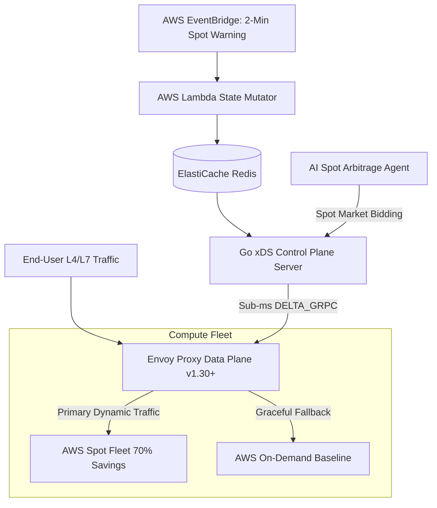

<p align="center">
  
</p>

<h1 align="center">Conscious Cloud</h1>

<p align="center">
  <strong>Autonomous Intra-Cloud Compute Arbitrage Engine &amp; Zero-Drop Envoy Proxy xDS Orchestrator.</strong>
</p>

<p align="center">
  
  
  
  
  <a href="future.md"></a>
</p>

---

## ⚡ Overview

**Conscious Cloud** is an AI-driven, zero-drop L4/L7 traffic orchestrator designed to dynamically route stateless microservice workloads across AWS On-Demand and Spot instances using Envoy Proxy and Delta xDS.

By anticipating spot termination warnings and streaming incremental topology mutations down to Envoy via gRPC, Conscious Cloud slashes cloud infrastructure costs by up to 70% while guaranteeing zero dropped connections.

---

## 🏗️ System Architecture



### 🧩 Component Breakdown
* **Data Plane:** Envoy Proxy (v1.30+)
* **Control Plane:** Custom Go server utilizing `envoyproxy/go-control-plane`
* **Orchestrator:** AI agent (Python/Go) evaluating AWS Spot pricing and triggering mutations
* **State Management:** Amazon EventBridge -> AWS Lambda -> Redis (ElastiCache)
* **Workload Decoupling:** Amazon SQS / RabbitMQ

---

## 🚀 Core Features

* **Zero-Drop Connection Draining:** Mathematically tuned `drain_timeout` and active connection shedding prevent HTTP 502/504 errors during instance terminations.
* **Sub-Millisecond Topology Updates:** Real-time cluster membership synchronization via the `DELTA_GRPC` xDS protocol without server reloads.
* **Race Condition Immunity:** Multi-tiered active health checking prevents blackhole routing to unready nodes.
* **API Throttling Bypass:** 100% event-driven AWS state tracking via EventBridge (Zero polling).
* **2-Minute Cliff Survival:** Native support for the Hurry-Up-and-Get-Idle (HUGI) pattern and NVMe checkpointing.

---

## 📁 Repository Structure

```plaintext
/conscious-cloud
├── control-plane/       # Go-based xDS Server implementation
├── data-plane/          # Envoy configurations (envoy.yaml, TLS certs)
├── orchestrator/        # AI Agent logic and Spot market evaluation
├── infrastructure/      # Terraform modules (VPC, EC2, EventBridge, Redis)
├── workers/             # Dummy stateless workers for testing (Go/Python)
└── Archives/            # Historical docs: ideas, specs, architecture
```

---

## 🛠️ Quick Start (Local Development)

### 1. Build and Run the Go Control Plane
```bash
cd control-plane
go run ./main.go
```

### 2. Launch the Envoy Data Plane
```bash
docker run --rm -v $(pwd)/data-plane/envoy.yaml:/etc/envoy/envoy.yaml \
  -p 10000:10000 envoyproxy/envoy:v1.30-latest
```

### 3. Trigger Arbitrage Test
Use the Orchestrator API to inject dummy node IPs and observe Envoy dynamic cluster rotation in real-time.

---

## 🔮 Engineering Roadmap

To explore planned features including carbon-intensity grid optimization, eBPF TCP socket migration, and multi-cloud spot federation across AWS/GCP, check out [future.md](future.md).

---

## 📄 License

This project is licensed under the Apache License 2.0.
